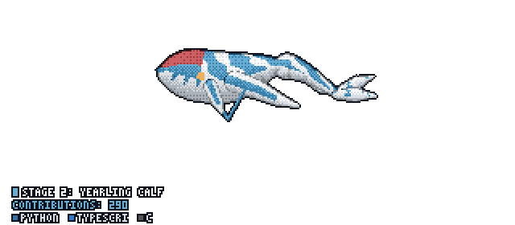

<!-- Banner -->
<p align="center">
  
</p>

<p align="center">
  <a href="https://dianalucero.vercel.app/">
    
  </a>
</p>

<p align="center">
  <a href="https://dianalucero.vercel.app/"></a>
  <a href="https://www.linkedin.com/in/dlucero0715"></a>
  <a href="https://devpost.com/httpsdluc"></a>
  <a href="mailto:dlucero0715@gmail.com"></a>
  
</p>

---

### 👋 Hey, I'm Diana

I'm a Computer Science student at **The City College of New York** who likes turning unstructured, messy data into software people actually use. Most of my work lives where **LLM agents, backend systems, and product** overlap. I mostly learn by building, usually at a hackathon at 3am.

```ts
const diana = {
  based: "New York City 🗽",
  studying: "CS @ The City College of New York",
  building: ["AI agents with guardrails", "full-stack products", "data pipelines"],
  currently: ["senior project: paid-on-time", "avionics flight computer @ CARE 🚀"],
  askMeAbout: ["LLM agents", "Next.js + FastAPI", "running a hackathon team"],
};
```

---

### 🔨 Things I've built

<table>
  <tr>
    <td width="50%" valign="top">
      <h4>🔐 <a href="https://github.com/httpsdluc/hackknights26">Cosign</a></h4>
      <sub><b>HackKnights '26</b></sub><br/>
      An AI agent recomputes every payment request a credit fund receives from source data, and a <b>Solana program makes it impossible for the agent to move money without human approval</b>.<br/><br/>
      
      
      
    </td>
    <td width="50%" valign="top">
      <h4>🧭 <a href="https://github.com/httpsdluc/specsync-ibm-bob">SpecSync</a></h4>
      <sub><b>Software assurance · IBM Bob</b></sub><br/>
      Passing tests don't mean correct software. SpecSync catches <b>semantic drift between specs, code, and tests</b>. In the demo it found 3 real defects in a service with 7/7 green tests.<br/><br/>
      
      
    </td>
  </tr>
  <tr>
    <td width="50%" valign="top">
      <h4>🌫️ <a href="https://github.com/httpsdluc/AirAware">AirAware</a></h4>
      <sub><b>HunterHacks '26</b></sub><br/>
      Air quality intelligence for New Yorkers, built for the Bronx neighborhoods where pediatric asthma ER rates run <b>4–5× the city average</b>.<br/><br/>
      
    </td>
    <td width="50%" valign="top">
      <h4>🎬 <a href="https://github.com/httpsdluc/Orchestrate-Studios">Orchestrate Studios</a></h4>
      <sub><b>IBM watsonx Orchestrate</b></sub><br/>
      A <b>multi-agent marketing pipeline</b> that turns one video into ready-to-post campaigns for every platform in minutes.<br/><br/>
      
      
    </td>
  </tr>
  <tr>
    <td width="50%" valign="top">
      <h4>🧠 <a href="https://github.com/httpsdluc/ctphacks-RJMD">ThinkPad</a></h4>
      <sub><b>CTPHacks</b></sub><br/>
      A coding coach that <b>asks instead of answers</b>. It's a Chrome side-panel extension that nudges you toward the solution instead of handing it over.<br/><br/>
      
    </td>
    <td width="50%" valign="top">
      <h4>📈 <a href="https://github.com/httpsdluc/yhacks26">YHack Investment Agent</a></h4>
      <sub><b>YHack '26</b></sub><br/>
      An AI investment analyst that combines fundamentals, news sentiment, and bias checks into a <b>four-pillar score and verdict</b>, with a chat interface on top.<br/><br/>
      
    </td>
  </tr>
</table>

<p align="center"><a href="https://github.com/httpsdluc?tab=repositories"><b>See all repos →</b></a></p>

---

### 🧰 Tech I reach for

<p align="center">
  <br/>
  <br/>
  
</p>

<p align="center">
  
  
  
  
  
  
</p>

---

### 📊 GitHub activity

<p align="center">
  <a href="https://github.com/PramudithaN/git-tulkun">
    
  </a>
  <br/><sub>🐋 My Tulkun grows with every contribution</sub>
</p>

<p align="center">
  
</p>

<p align="center">
  <picture>
    <source media="(prefers-color-scheme: dark)" srcset="https://raw.githubusercontent.com/httpsdluc/httpsdluc/snake/github-snake-dark.svg" />
    
  </picture>
</p>

---

<p align="center">
  <b>Always down to team up for a hackathon, talk agents, or grab coffee in NYC ☕</b><br/>
  If something here is useful or interesting, a ⭐ helps a lot!
</p>


